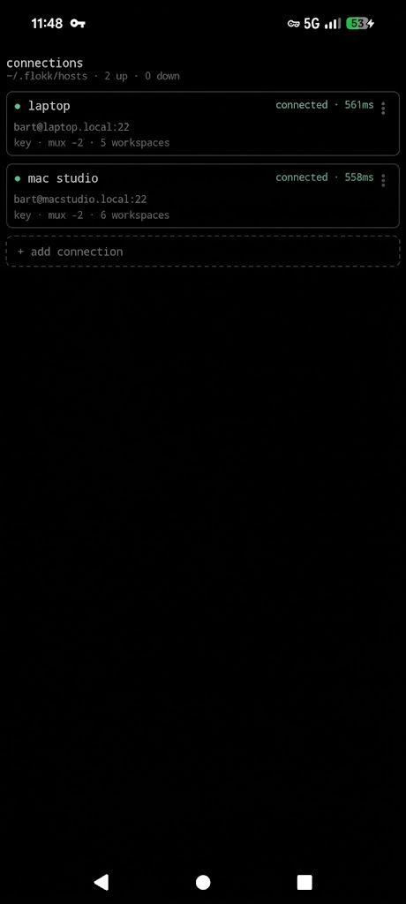
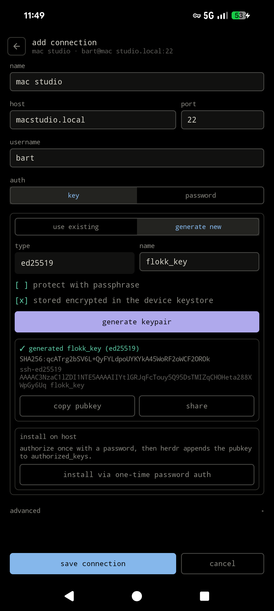
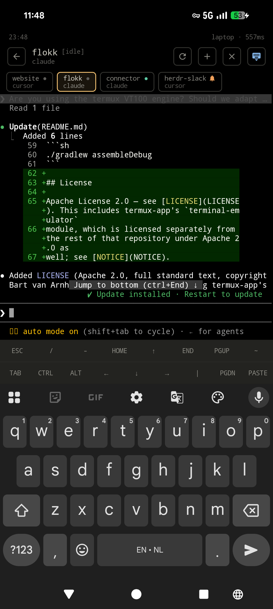
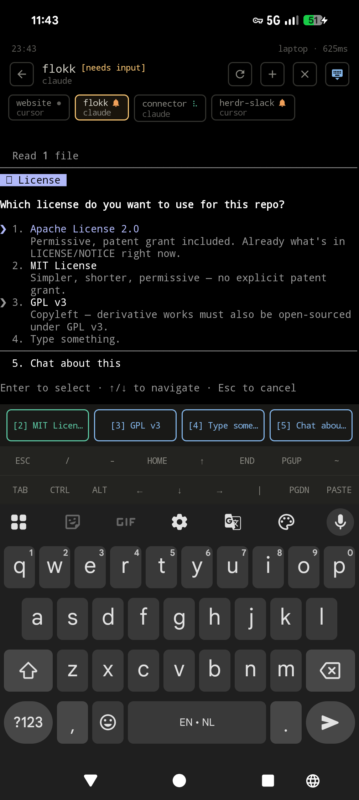

#  flokk

flokk is an Android client for [herdr](https://herdr.dev). It connects to a herdr host
over SSH, polls `workspace list` / `pane list` / `agent list` for the state of every
workspace, and attaches a live terminal to whichever
one you select.

<p>
  
  
  
  
</p>

## What it does

- **SSHes into a herdr host** and polls `workspace list` / `pane list` / `agent list`, so
  each workspace's agent state (idle, working, or blocked waiting on an answer) shows up
  in a tab strip as it changes.
- **Attaches a terminal** to the selected workspace, rendered with Termux's own VT100
  engine: a live PTY, not a text dump.
- **Parses agent prompts from the terminal output.** When the visible screen looks like a
  question, such as a numbered menu, `(y/n)`, or `(Y)es/(N)o`, flokk renders it as tappable
  buttons above the keyboard, so replying doesn't require typing.
- **Stores multiple host profiles**, each with its own auth (SSH key or password), optional
  jump host, and per-host herdr session/binary override, encrypted at rest via Android's
  Keystore.
- **Can generate an SSH key pair and install it on a host** over a one-time password
  (never stored), so a new host doesn't require a separate `ssh-copy-id` step.

It only understands herdr's workspace/pane model; it isn't a general-purpose SSH client.
For plain shell access, use something like Termux or Termius.

## Getting started

Requirements: Android 8.0 (API 26) or newer, and a machine reachable over SSH with
[herdr](https://herdr.dev) installed and running.

1. Install flokk (see [building from source](#building-from-source) below; there's no
   Play Store listing yet).
2. Open the app and tap **+ add connection**. Fill in host, port, and username. For auth,
   either paste an existing private key or have flokk generate one and install it on the
   host.
3. If herdr needs `HERDR_SESSION` set, or isn't on the default `PATH` for a non-interactive
   SSH exec session, set **session** / **binary** under **advanced**.
4. Tap the connection to sign in. It lands on whichever workspace herdr reports first; the
   tab strip along the top switches between the rest.

## Connecting when you're not on the same network

Not on the same LAN as your herdr host? Install [Tailscale](https://tailscale.com) on both
the host and the phone (same account), then use the host's Tailscale name or `100.x.y.z` IP
as flokk's **host**. No port-forwarding needed.

## Building from source

Open the repo root in Android Studio (Ladybird/Koala or newer); it resolves the Gradle
wrapper (`./gradlew`, Gradle 8.9) and dependencies automatically, including from
[JitPack](https://jitpack.io) (used for Termux's `terminal-emulator` module, which isn't on
Maven Central). Minimum SDK 26.

Or from the command line, with `ANDROID_HOME` pointed at an installed SDK:

```sh
./gradlew assembleDebug
```

## License

Apache License 2.0; see [LICENSE](LICENSE). This includes termux-app's `terminal-emulator`
module, which is licensed separately from the rest of that repository under Apache 2.0 as
well; see [NOTICE](NOTICE).
